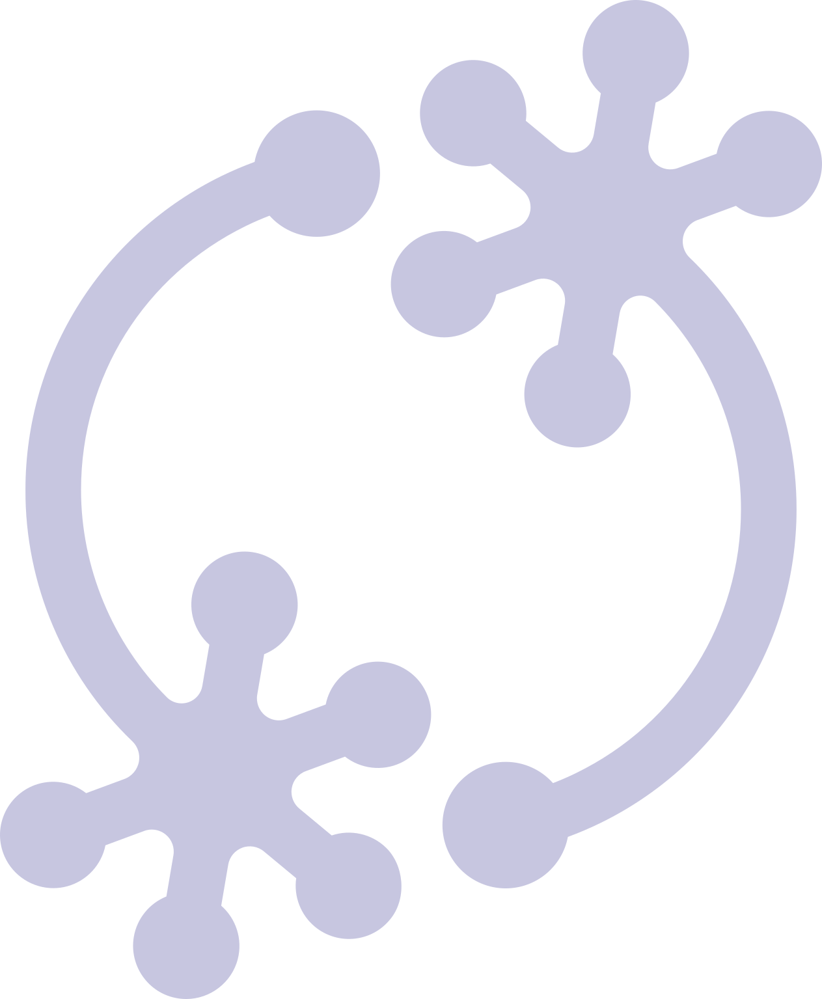

+++ {"kind": "split-image", "class": "landing-hero"}

Neuromatch Impact Scholars Program

## Impact Scholars Gallery

Research papers from Neuromatch's six-month mentored research program, open to read and cite.

{button}`Latest edition <impact-scholars/impact-scholars-2025.md>` [About the program](impact-scholars.md)

+++ {"kind": "centered", "class": "landing-editions"}

Editions

## Browse by cohort

::::{grid} 1 1 2 2

:::{card} 2025 Edition
:link: impact-scholars/impact-scholars-2025.md
Neuroscience and climate science.
:::

:::{card} 2023 Edition
:link: impact-scholars/impact-scholars-2023.md
Computational tools for climate science.
:::

::::

+++ {"kind": "justified", "class": "landing-latest"}

Latest papers

## From the 2025 edition

::: {paper-cards}
:subset: 2025
:::

+++ {"kind": "justified", "class": "landing-join"}

Take part

## Join a research group

Scholars from Neuromatch Academy's courses work in small groups with a mentor, and each group publishes its work here.

{button}`How to participate <submission-guidelines.md>` [neuromatch.io](https://neuromatch.io/impact-scholars-program/)
